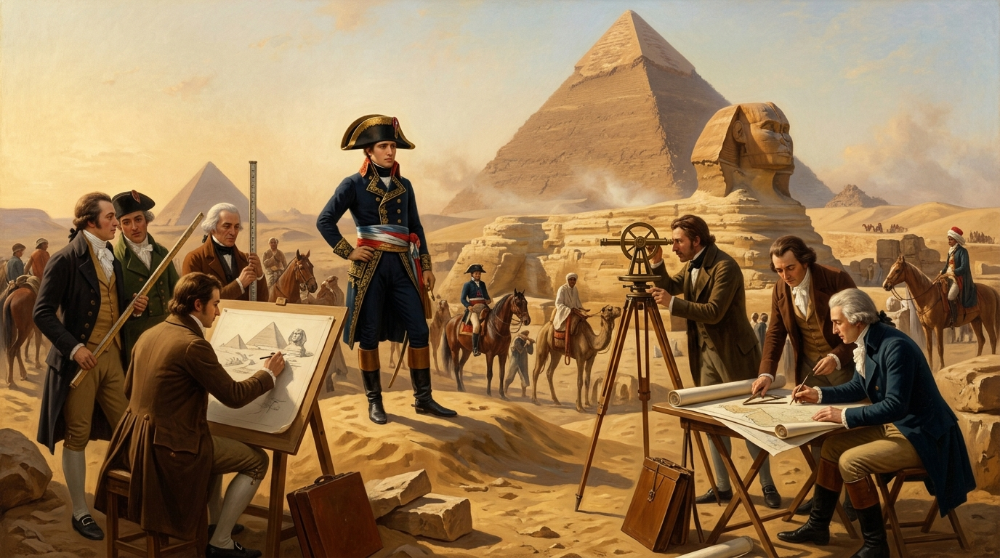
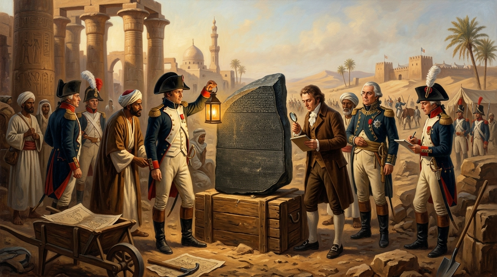
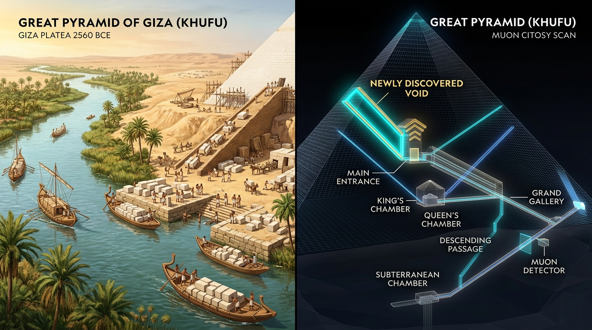

# Haytham's Pre-Lesson & Conversation Notes: Napoleon & The Pyramids (1798–1801)

---

## 1. Pre-Lesson Study Notes: Napoleon & The Pyramids

### A. The 167 Savants & The Birth of Egyptology (1798)
1. **Soldiers + Scientists**: When 29-year-old Napoleon Bonaparte sailed to Egypt in 1798, he brought **167 *savants***—France's top engineers, mathematicians, artists, and historians—to map Egypt and measure the Pyramids of Giza with scientific precision for the first time.
2. **The Battle of the Pyramids Quote**: Before facing the Mamluk cavalry within sight of Giza, Napoleon pointed to the pyramids and told his soldiers:
   > *"Soldiers! From the heights of these pyramids, forty centuries look down upon you."*
3. **The Wall Around France Calculation**: While at Giza, Napoleon and mathematician Gaspard Monge calculated that the stone blocks from the three Giza pyramids could build a wall **3 meters high and 30 cm thick** around the entire border of France.
4. **The *Description de l'Égypte***: The savants spent years creating thousands of detailed drawings of pyramids, temples, and daily life in Egypt, publishing a 24-volume encyclopedia that sparked "Egyptomania" worldwide.

> **Myth vs. Fact — Who Broke the Sphinx's Nose?**  
> Tourists often claim Napoleon's soldiers shot the nose off the Great Sphinx with a cannon. **This is a myth!** Drawings made by Danish traveler Frederic Louis Norden in **1737** (32 years before Napoleon was even born!) already show the Sphinx without a nose, and 15th-century Egyptian historian **al-Maqrizi** recorded that it was broken off in **1378 CE**.

---

### B. The Rosetta Stone (Rashid, 1799) & Napoleon Inside the Great Pyramid
1. **Discovery in Rashid (Rosetta)**: For over 1,400 years, nobody could read ancient Egyptian hieroglyphs. In July 1799, French soldiers rebuilding a fort in Rashid uncovered a dark stone slab carved with the same decree in **three scripts**:
   * **Hieroglyphs** (sacred script)
   * **Demotic** (everyday Egyptian script)
   * **Ancient Greek** (which scholars could already read)
2. **Cracking the Code**: French scholar **Jean-François Champollion** used the Greek text on the Rosetta Stone to finally **decipher** hieroglyphs in 1822. However, when the British defeated the French in 1801, Britain seized the Rosetta Stone and took it to London.
3. **Napoleon’s Secret Night in Khufu's Pyramid**: In August 1799, Napoleon visited the King's Chamber inside the Great Pyramid of Khufu and asked to be left completely alone inside the dark granite room. When he came out, he was reportedly pale and shaken. When asked if he had seen anything mysterious, he replied:
   > *"Even if I told you, you would never believe me."*

---

## 2. Key Vocabulary & Grammar to Use in the Lesson

| Vocabulary | IPA | Arabic | Meaning | Example Sentence |
| :--- | :--- | :--- | :--- | :--- |
| **Savant** *(n.)* | `/sæˈvɑːnt/` | عالِم / باحث | A deeply learned scientist or scholar | *Napoleon brought 167 savants to measure the pyramids and study the Nile.* |
| **Decipher** *(v.)* | `/dɪˈsaɪ.fər/` | يفك شفرة / يفسر | To decode or figure out an ancient script | *The Rosetta Stone helped Champollion decipher Egyptian hieroglyphs.* |
| **Deface** *(v.)* | `/dɪˈfeɪs/` | يشوّه معالِم | To damage or spoil the surface of a monument | *Many people wrongly blame Napoleon for defacing the Great Sphinx.* |
| **Repatriate** *(v.)* | `/ˌriːˈpæt.ri.eɪt/` | يعيد إلى الوطن | To return an artifact to its home country | *Many Egyptians believe the British Museum should repatriate the Rosetta Stone.* |
| **Expedition** *(n.)* | `/ˌek.spəˈdɪʃ.ən/` | حملة / بعثة | A journey for war or scientific exploration | *While the military expedition failed, the scientific mission changed history.* |
| **Legacy** *(n.)* | `/ˈleɡ.ə.si/` | إرث تاريخي | What a person or event leaves behind in history | *The birth of modern Egyptology was a lasting legacy of the 1798 campaign.* |
| **Non-invasive** *(adj.)* | `/ˌnɒn.ɪnˈveɪ.sɪv/` | غير جراحي / بدون تدمير | Scanning without damaging the structure | *Scientists use non-invasive cosmic-ray scans to look inside Khufu's pyramid.* |
| **Void / Chamber** *(n.)* | `/vɔɪd/` | فراغ / حجرة داخلية | An empty space inside a solid structure | *In 2023, cameras confirmed a hidden 9-meter void above the Great Pyramid's entrance.* |
| **Logistics** *(n.)* | `/ləˈdʒɪs.tɪks/` | العمليات اللوجستية | Detailed organization of a complex operation | *The logistics of transporting granite blocks from Aswan to Giza required canals and boats.* |
| **Tributary / Branch** *(n.)* | `/ˈtrɪb.jʊ.tər.i/` | فرع نهر / رافد | A river branch flowing into or out of a main river | *The ancient Ahramat branch of the Nile flowed right past the Giza plateau.* |
| **Skeptical** *(adj.)* | `/ˈskep.tɪ.kəl/` | مشكك / مرتاب | Having doubts or reservations about a claim | *Historians are skeptical about Napoleon's dramatic story inside the King's Chamber.* |
| **Preservation** *(n.)* | `/ˌprez.əˈveɪ.ʃən/` | حفظ / صيانة الآثار | Keeping an ancient monument safe from harm | *Tourism brings revenue, but preservation of the pyramids must come first.* |

---

## 3. Grammar Boost: Speculating About the Past (`Modal + have + Past Participle`)
* **`must have + V3`** *(90–100% sure)*: *"Champollion **must have felt** amazed when he finally deciphered the hieroglyphs."*
* **`might / could have + V3`** *(50% possible theory)*: *"Napoleon **might have had** a psychological experience inside the King's Chamber, or he **could have invented** the story to seem mysterious."*
* **`can't / couldn't have + V3`** *(0% impossible)*: *"Napoleon's soldiers **couldn't have broken** the Sphinx's nose in 1798 because drawings from 1737 show it was already gone!"*

---

## 4. Conversation Questions for the Lesson
1. **Warm-Up**: *From the pre-lesson activity, which fact or myth about Napoleon and the pyramids surprised you the most?*
2. **Egyptian Perspective**: *How is Napoleon’s 1798 expedition (*Al-Hamla Al-Faransiyya*) taught in schools in Egypt today? Is he remembered more as a military invader or for the scientific work of the savants?*
3. **The Sphinx Myth**: *Why do you think the rumor blaming Napoleon for the Sphinx's nose became so popular around the world? What other myths do tourists believe about the pyramids?*
4. **The King's Chamber**: *What do you think happened when Napoleon was alone inside the Great Pyramid? Have you ever been inside a pyramid's burial chamber—what does the atmosphere feel like?*
5. **The Rosetta Stone Debate**: *Now that Egypt has built the massive Grand Egyptian Museum (GEM) right next to the Giza Pyramids, should the British Museum **repatriate** the Rosetta Stone to Egypt?*
